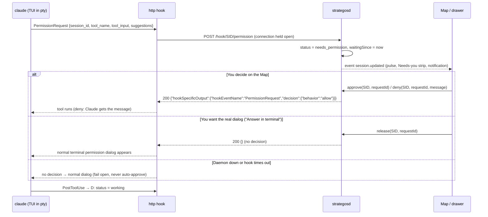
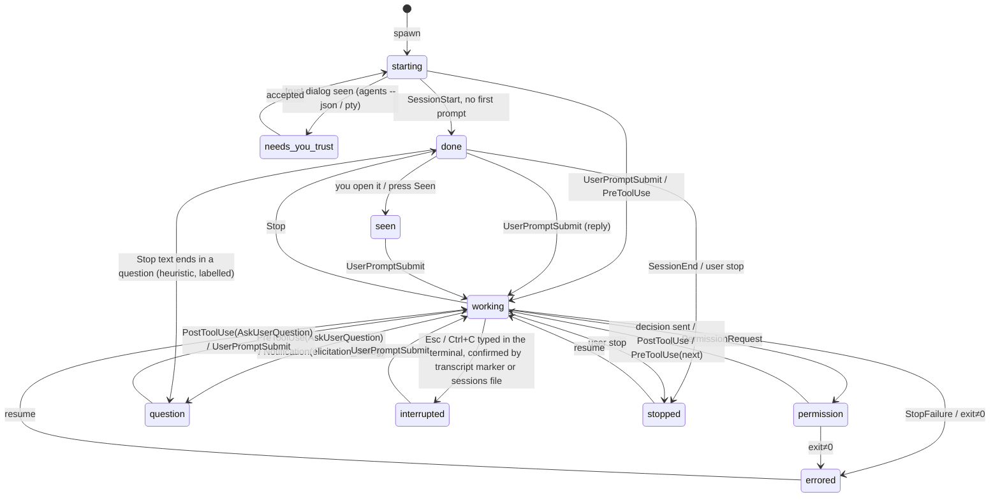

# Strategos: technical write-up and build decision

Status: decision draft, revision 2 (11 Oct 2026). Machine: Windows 10 Pro 19045, Claude Code CLI 2.1.292 (npm) plus the desktop app's bundled 2.1.295.
Written by the Opus advisor pass. Every fact is marked **[verified]** (seen on this machine), **[docs]** (quoted from code.claude.com, fetched 10 Oct 2026) or **[assumed]** (still unproven; the spike has to settle it). Section 9 lists them all.

**What changed in revision 2:** the Bot Crossing review (`bot-crossing-review.md`) is merged into §3.3, §3.6, §3.7, §4, §5, §6, §7, §8 and §9. The feature backlog you chose is §10. §11 lists every edit made in this revision. Tags **[review]** mark merged review points, and **[recalled]** marks claims the reviewing advisor remembered from the hook docs without re-reading them; the Phase 0 checks S11–S14 settle those. A separate document, `strategos-implementation-plan.md`, was written afterwards by another advisor pass; it re-checked several of these claims against the docs, and where it disagrees with this write-up, the plan is newer.

---

## 1. Summary and recommendation

**Build:** a TypeScript daemon (`strategosd`) that owns every Strategos session as an ordinary interactive `claude` process inside a pseudo-terminal (node-pty, which uses ConPTY on Windows and forkpty on macOS). The daemon serves a web UI over a loopback WebSocket. The UI is the Map (SVG), the drawer, and xterm.js terminals. It runs in a browser window first, and an Electron shell wraps it from Phase 4. Status, permission requests and activity reach the daemon through hooks injected per process with `--settings` (Strategos never edits `~/.claude/settings.json`). Context fill and cost come from a status-line tap. The chat view is drawn from the same live session's transcript plus hook events, so there is no process switch.

**Why this option:**
1. **It meets both hard requirements.** You get the real terminal UI, so slash commands, dialogs and your mods keep working, and you get the Map with approvals that happen in place.
2. **It builds today with what is installed.** Node 24 and npm 11 are present. node-pty 1.1.0 ships prebuilt binaries for win32-x64, darwin-x64 and darwin-arm64 through N-API, so no compiler is needed. Rust, MSVC Build Tools and the .NET SDK are all absent. Tauri or WinUI would each start with a multi-GB toolchain install.
3. **One language for the hard part.** The difficult code is the daemon: hooks, transcript parsing, the state machine, git and gh. It is the same code on Mac. The shell (browser, Electron, or Tauri later) is a thin, swappable layer.

**Cost:** about **7–9 focused weeks** to a full v1 (single developer working with Claude). It becomes usable day to day after about 4 weeks (end of Phase 2: terminals, live status, Map, approvals from the Map). Phase 0 is a 2–3 day spike.

**Revision 2 note on cost.** The 7–9 weeks predates the review gaps and the 16 chosen features (§10 adds about 2.5 weeks by my estimate). The separate implementation plan, which budgets for the test harness and the review gaps, gives 13–16 weeks for one person working serially and 9–11 weeks with three parallel helper lanes. That is that advisor's figure; I have not re-derived it, and I'd treat it as the better number.

**Where I disagree with earlier conclusions:**
- **"Pure mod first."** This was right for an observer of desktop-app sessions. It is wrong now that Strategos replaces the window and only has to show sessions it starts. A mod lives inside one terminal and cannot be the window that holds the Map and many sessions. Keep one piece of the idea: the per-session "sensor" is a hooks bundle Strategos injects. It is not a mod you install globally.
- **Tauri leaning.** It is not wrong, but it buys little here: a smaller binary and Rust's `portable-pty`. It costs a toolchain install and either a second language or a Node sidecar. The UI is web either way, so you can move to Tauri later without touching the daemon.
- **"Chat view = stop the TUI, `--resume` headless, switch back."** Mechanically plausible, but the wrong default (see §3.4). The docs say two processes on one session interleave into one transcript. A switch has to kill any in-flight turn. The headless process loads your mods without their UI. Each switch costs a restart and probably a prompt-cache miss. Draw the chat view from the live session instead. Keep resume-switching only as a fallback for "headless sessions" later.
- **New option the earlier pass did not have:** Claude Code's own **background supervisor and Agent View** (`claude --bg`, `claude attach`, `claude agents --json`). It exists in this version and runs on Windows. `claude agents --json` is documented as *"the supported way to read session state from outside Claude Code."* I use it as a reconciler from day one, and the spike tests it as an alternative session host (Option E).

**What would change my mind:**
- **Spike S3 fails** (xterm.js on Windows 10 ConPTY cannot render the fullscreen TUI acceptably, even with node-pty's bundled conpty.dll). Then switch hosting to Option E (supervisor plus `claude attach`), or to a "Map plus external terminal windows" variant.
- **Spike S2 fails** (a PermissionRequest hook cannot hold a request while you decide, then release it to the terminal dialog). Then approvals from the Map shrink to "Notification → jump to the terminal". This is still useful, but the drawer's Approve/Deny would type into the terminal dialog instead.
- **Option E proves stable in the spike.** It hands you survival across app restarts, idle-process reaping and worktree cleanup for free. If so, prefer it as the host and keep node-pty only for the visible attach pane.

---

## 2. Building options compared

Effort means weeks to a v1 with the binding requirements. Map fidelity means how much of look B (planets, orbits, needs-you strip, in-place actions) you get.

| Option | Effort | Risk | Map fidelity | Real TUI | Mac later | Depends on unverified |
|---|---|---|---|---|---|---|
| **A** Mod only (function-hook plugin, `$.ui` panes) | 1–2 wk | Low | Low: a pane inside one terminal, not a window | Yes (it *is* the TUI) | Yes | Pane API limits; can't host other sessions |
| **B1** Node daemon + node-pty + web UI in **Electron** *(recommended)* | 7–9 wk | Medium | Full | Yes | Yes (node-pty darwin prebuilds) | S1–S6, S9, S10 |
| **B2** **Tauri** (Rust) + portable-pty + web UI | 8–11 wk | Medium | Full | Yes | Yes | Same as B1, plus Rust/MSVC install, plus Rust or sidecar for the daemon |
| **B3** Node daemon + browser/PWA window (no Electron) | 6–8 wk | Medium-low | Full, minus tray, global hotkeys, rich notifications | Yes | Yes | Same as B1 (this is B1's Phases 1–3) |
| **B4** .NET / WinUI 3 shell + ConPTY | 9–12 wk | Medium | Full | Yes (needs WebView2 + xterm.js anyway) | No (rewrite) | .NET SDK not installed |
| **C** Headless only: `claude -p --input/output-format stream-json` or Agent SDK `canUseTool` | 5–7 wk | Medium | Full for chat; no terminal | **No** (mods, pickers, TUI dialogs lost) | Yes | SDK auth terms if published |
| **D** Hooks in global `settings.json` + observer window | 3–4 wk | Low | Full view, but observe and approve only | n/a (sessions live elsewhere) | Yes | Violates "don't edit global settings"; not needed since only own sessions count |
| **E** First-party supervisor: `claude --bg` + `claude attach` in a pty + `claude agents --json` | 5–7 wk | Medium-high | Full | Yes (via attach) | Yes | S8; research preview; background-only behaviours |
| **F** VS Code extension (webview Map + VS Code terminals) | 5–7 wk | Medium | Partial: Map and terminals in separate panels, can't read terminal buffer | Yes | Yes | Ties Strategos to VS Code; doesn't replace the Claude window |

**A. Mod only.** Fastest, and it really is the TUI. But a mod renders inside one session's terminal and can't be a window that shows planets, a needs-you strip and *other* sessions' terminals. It also can't start or stop sibling sessions cleanly. That made it a good observer. It fails "replaces my Claude window". Rejected as the core. Kept as an optional later extra: a small band inside each session, such as "2 others need you".

**B1. Electron + node-pty (recommended).** One language end to end. node-pty is Microsoft's (MIT, 1.1.0, updated Aug 2026) and powers VS Code's terminal, so its ConPTY path is the most battle-tested there is. xterm.js 6.0.0 (MIT) is the same renderer VS Code uses. Electron (44.x, MIT) adds a tray, global hotkeys, native notifications and a single-window feel. The cost is about 150 MB on disk and about 150 MB of RAM, which is minor next to Claude itself: each live `claude.exe` here uses **300–450 MB working set and 600–830 MB private** [verified].

**B2. Tauri.** The right instinct if this were a product to distribute widely: a small binary and good security defaults. Here it means installing Rust plus MSVC Build Tools (both absent), then writing hooks, transcript parsing and git in Rust, or running a Node sidecar anyway. `portable-pty` (wezterm, MIT) is solid. Worth reconsidering after v1. The daemon/UI split makes the swap cheap.

**B3. Daemon + browser window.** Not a separate destination but the first half of B1. Phases 1–3 ship as `strategosd` plus a page opened in an Edge/Chrome app window. It needs no packaging, is fastest to iterate on, and is equally Mac-ready. Electron arrives when you want the tray, global hotkeys and OS notifications.

**B4. .NET/WinUI.** A native Windows feel, but you still need xterm.js in WebView2 for a decent terminal. The .NET SDK isn't installed (only x86 runtimes 5–7), and everything is rewritten for Mac. Rejected.

**C. Headless only.** This is exactly how the Claude desktop app runs Code sessions on this machine. Its processes run `claude.exe --output-format stream-json --input-format stream-json --permission-prompt-tool=stdio --include-partial-messages --replay-user-messages --settings {…}` [verified, process command lines]. That gives the best chat view, with token streaming and a clean permission callback. But it drops your binding requirement (a): no real TUI, no mods UI, no slash-command pickers. If Strategos is ever published, the Agent SDK docs add a constraint: *"Unless previously approved, Anthropic does not allow third party developers to offer claude.ai login … including agents built on the Claude Agent SDK"* [docs]. Rejected as primary. Its event schema still informs the chat-view model.

**D. Global hooks + observer.** Was right when the goal was watching desktop-app sessions. Now it violates "Strategos must not edit the user's global settings" and solves a problem you no longer have. Rejected.

**E. First-party supervisor.** New since the earlier pass, and strong:
- Sessions survive the app closing, because the supervisor hosts them [docs].
- `claude agents --json` gives `status` (busy/waiting/idle), `waitingFor` (permission prompt, input needed, dialog open…) and `state` (working/blocked/done/failed/stopped) as a *supported* interface [docs; ran it here and got interactive sessions with `status`].
- Idle sessions are reaped after about an hour and transparently resumed.
- `claude -p --resume <id> "text"` sends a reply to a running background session [docs].
- The Windows-specific changelog entries show it ships on Windows [docs].

The minuses:
- It's a **research preview** with heavy churn: dozens of behaviour changes across 2.1.139–2.1.285.
- Background sessions behave differently. For example, a background session isolated in a worktree *"commits, pushes its own isolated branch … and opens a draft pull request when it finishes instead of asking first"* [docs].
- `←` in an attached session navigates to Agent View inside your pane.
- Seeing the TUI needs an extra `claude attach` process per visible session.

This is the main alternative host, and the spike tests it (S8).

**F. VS Code extension.** Credible, since VS Code terminals are real ptys and webviews can draw the Map. But terminals and the Map can't be composed into one surface. An extension can't read a terminal's screen. And it makes VS Code the Claude window, which isn't what you asked for. Rejected.

**Ranking:** B1 (built through B3) > E > B2 > C > F > A > B4 > D.

---

## 3. Architecture (recommended option)

### 3.1 Process model

```mermaid
flowchart LR
  subgraph UI["Strategos UI (browser window → Electron renderer)"]
    MAP[Map + Needs-you strip]
    DRAWER[Drawer: Terminal | Chat | Review]
    XT[xterm.js per open session]
  end
  subgraph D["strategosd (Node 24, TypeScript, detached process)"]
    WS[WebSocket API 127.0.0.1:random + token]
    HK[Hook receiver HTTP 127.0.0.1 /hook/:sid]
    SM[Session manager + state machine]
    PTY[node-pty hosts]
    TT[Transcript tailer]
    GIT[git / gh adapter]
    REC[Reconciler: sessions folder + claude agents --json]
    ST[(~/.strategos state + event log)]
  end
  subgraph S["One per session"]
    C1["claude (interactive TUI) --session-id U --settings strategos.json --name N"]
    SL[statusline tap]
  end
  UI <-- WS --> WS
  PTY -- ConPTY / forkpty --> C1
  C1 -- http hooks --> HK
  SL -- POST status JSON --> HK
  TT -- reads --> J[(~/.claude/projects/…/U.jsonl)]
  C1 -- writes --> J
  REC -- reads sessions folder every 2–5 s --> SESS[(~/.claude/sessions/*.json)]
  REC -. startup, ~60 s, on disagreement .-> CLI[claude agents --json]
  GIT --> R[(repos / worktrees)]
  SM --- ST
```

- **The UI does not own processes.** `strategosd` is started by the UI if it isn't running, and keeps running when the window closes, so sessions survive a UI reload or crash. Electron's main process only launches and connects to it.
- **The daemon spawns one `claude` per session in a pty.** It runs the resolved native binary, not the npm shim: `claude.cmd` just calls `node_modules\@anthropic-ai\claude-code\bin\claude.exe` [verified]. Every spawn passes:
  - `--session-id <uuid>`, chosen by Strategos so identity is known before the first hook fires. **[review]** That id is only the *first* Claude id of the session. `/clear` (and probably plan mode's "clear context") starts a new `session_id` inside the same process, and `/resume` typed in the terminal can switch to another session. So Strategos keeps its own id for the session and a list of every Claude id it has owned (§4.1). Hook URLs are keyed by the Strategos id;
  - `--name <name>`;
  - `--settings <path to ~/.strategos/run/<uuid>.settings.json>`;
  - any user-chosen extras (`--model`, `--permission-mode`, `--add-dir`).
- **Spawn environment.** The daemon scrubs `CLAUDECODE`, `CLAUDE_CODE_*`, `CLAUDE_AGENT_SDK_*` and `ANTHROPIC_BASE_URL`/`ANTHROPIC_API_KEY` from the child environment unless configured otherwise. This shell, itself a child of the desktop app, carries about 30 of those variables, including `ANTHROPIC_BASE_URL` and `CLAUDE_CODE_SIMPLE` [verified]. A Strategos started from inside a Claude session would otherwise pass them on. Removing `ANTHROPIC_API_KEY` keeps sessions on your subscription login, because the key outranks `/login` [docs]. **[review]** The scrubber must keep `CLAUDE_CONFIG_DIR` (it moves where `~/.claude` lives), and every path the daemon reads under `~/.claude` honours it.

### 3.2 What the injected settings contain

`--settings` values *"override the same keys in your settings.json files for this session"*, and *"Hook entries merge across settings levels rather than replacing each other"* [docs]. So Strategos adds hooks without touching yours, and your plugins and mods still load. The desktop app uses `--settings` the same way next to `--setting-sources=user,project,local` [verified].

```json
{
  "hooks": {
    "SessionStart":      [{ "hooks": [{ "type": "http", "url": "http://127.0.0.1:PORT/hook/SID", "timeout": 5 }]}],
    "UserPromptSubmit":  [{ "hooks": [{ "type": "http", "url": "…", "timeout": 5 }]}],
    "PreToolUse":        [{ "matcher": "*", "hooks": [{ "type": "http", "url": "…", "timeout": 5 }]}],
    "PostToolUse":       [{ "matcher": "*", "hooks": [{ "type": "http", "url": "…", "timeout": 5 }]}],
    "PermissionRequest": [{ "matcher": "*", "hooks": [{ "type": "http", "url": "…/permission", "timeout": 86400 }]}],
    "Notification":      [{ "hooks": [{ "type": "http", "url": "…", "timeout": 5 }]}],
    "Stop":              [{ "hooks": [{ "type": "http", "url": "…", "timeout": 5 }]}],
    "StopFailure":       [{ "hooks": [{ "type": "http", "url": "…", "timeout": 5 }]}],
    "SubagentStart":     [{ "hooks": [{ "type": "http", "url": "…", "timeout": 5 }]}],
    "SubagentStop":      [{ "hooks": [{ "type": "http", "url": "…", "timeout": 5 }]}],
    "PreCompact":        [{ "hooks": [{ "type": "http", "url": "…", "timeout": 5 }]}],
    "SessionEnd":        [{ "hooks": [{ "type": "http", "url": "…", "timeout": 2 }]}]
  },
  "statusLine": { "type": "command", "command": "\"…\\strategos-statusline.exe\" SID", "refreshInterval": 5 }
}
```

Notes:
- **`http` hooks.** They exist and POST the hook JSON [docs]. That avoids starting a Node process per hook on Windows, which costs about 100 ms each time. If the daemon is down, the connection fails and the hook gives no decision. By default that is fail-open [docs: "a timed-out hook renders no decision", default `onFailure: continue`]. Fallback if http hooks misbehave: a tiny command hook (`strategos-hook.exe`, built once with Node SEA or `pkg`).
- **Auth.** Each session's hook URL carries a per-session random secret (`/hook/<sid>/<secret>`). Header-based auth for http hooks is [assumed]; check it in S1.
- **Status line conflicts.** `statusLine` is a single scalar key, so the injected one would replace yours. The tap therefore *chains*. It reads the status JSON on stdin, posts it to the daemon, then runs the status line from your effective user or project settings (if any) with the same stdin and prints that output. None of your four enabled plugins sets `statusLine` in `settings.json` [verified]. If a plugin supplies a status line another way, S5 must check the chain.

### 3.3 Data flows

| Need | Primary source | Fallback / cross-check |
|---|---|---|
| Lifecycle, working/idle | Hooks: UserPromptSubmit, PreToolUse, Stop, StopFailure, SessionEnd | `claude agents --json` `status`/`waitingFor` (documented), pty exit event |
| Needs permission (with tool and input) | PermissionRequest hook (`tool_name`, `tool_input`, `permission_suggestions`) | Notification `permission_prompt`; `waitingFor: "permission prompt"` |
| Has a question | PreToolUse matcher `AskUserQuestion` (question text in `tool_input`); Notification `elicitation_dialog` | Stop + heuristic on `last_assistant_message` (ends in a question) |
| Done | Stop (`last_assistant_message` = preview) | Notification `idle_prompt`; `status: idle` |
| Errored | StopFailure; pty exit with non-zero code while not stopping | `state: failed` |
| Current tool ("now") | PreToolUse `tool_name` + summarised `tool_input`; cleared on PostToolUse/Stop | Transcript tail |
| Context fill | Status-line tap: `context_window.used_percentage`, `context_window_size` | Transcript: last main-chain assistant `usage.input_tokens + cache_creation_input_tokens + cache_read_input_tokens` ÷ window (window from model table) [verified fields] |
| Cost | Status-line `cost.total_cost_usd` (*"computed client-side at list price … may differ from your actual bill"*) | Transcript usage × price table |
| Subscription pressure | Status-line `rate_limits.five_hour/seven_day.used_percentage` | none |
| Repo, branch | git in the worktree; transcript lines carry `gitBranch`, `cwd` [verified] | Status-line `workspace.git_worktree` |
| Chat view content | Transcript JSONL tail (`transcript_path` arrives in every hook) | none |

**Cost on a subscription.** On a subscription the dollar figure is notional (an API-equivalent). Show it as "≈ $3.42" and add a small 5-hour-limit gauge in the top bar, which is the number that actually throttles you.

**Hook-free fallback (transcript reconciler)** **[review]**. Hooks will be silent in at least three cases: before workspace trust is accepted, across a daemon restart in the middle of a turn, and if http hooks misbehave. For those, the daemon runs a reconciler that reads the end of the transcript (the last 64 KB) and applies Bot Crossing's "whose turn is it" test: the last record is a user turn or tool result, so the model speaks next, or the last assistant message called no tool, so the turn was handed back. Rules:
- Every state it produces is labelled as inferred (`statusSource: transcript`).
- It **never clears a pending permission or question.** A permission wait looks exactly like "running a tool" in a transcript (both end in an assistant tool call), which is why Bot Crossing shows blocked sessions as busy.
- It can move working → done or interrupted, never the reverse of a hook-reported state.

**What a transcript can and cannot tell us** **[review]**. Can: title (custom, AI, summary, first prompt, in that order), cwd, git branch, whose turn it is, subagent briefs, token usage. Cannot: permission waits, errors for terminal sessions, interrupts (except as a user-record marker), process liveness, cost, context-window size. Subagent transcripts can open with a fork reference and no brief, and briefs can exceed 8 KB.

**Reconciler cost** **[review]**. Running `claude agents --json` every 5–10 s starts a native Claude binary each time on Windows [inferred; measured in S13]. `~/.claude/sessions/<pid>.json` already carries `status`, so the reconciler reads that folder every 2–5 s, checking pid and `procStart`, and calls the CLI only at startup, about once a minute, and when the two disagree.

### 3.4 Terminal view and chat view on one session

Your working assumption was "both modes read the same on-disk session; switching = stop one, `--resume` in the other".

- **Mechanically supported, but not verified here.**
  - Both interactive and `-p`/SDK sessions are stored in `~/.claude/projects/<encoded-cwd>/<id>.jsonl` [docs]. On this machine, desktop-app (stream-json) sessions and a CLI session sit in the same store [verified].
  - `claude --resume <id>` finds `-p` sessions even though the picker hides them [docs].
  - No session on this machine has ever crossed modes: every transcript has one `entrypoint` [verified]. So history continuity across modes is unproven.
- **Constraints that make it a poor default:**
  - *"If you resume the same session in two terminals without forking, messages from both interleave into one transcript"* [docs]. Agent View's docs add: *"Two processes can't write to the same transcript"* [docs]. A switch must kill the first process, including any in-flight turn, before starting the second.
  - The headless process starts with different flags (stream-json, a permission tool), so its tool list and system prompt can differ. That probably means a prompt-cache miss on the first turn after each switch [assumed]. Transcripts show 1-hour cache writes [verified], so a matching prefix would hit.
  - Your mods' UI (`$.ui` panes, bands, clawd-pet) doesn't exist in headless mode, so mods behave differently depending on which view you last chose.
  - Each switch takes a 2–5 s process restart [assumed].
- **Recommended instead:** one process per session, always the interactive TUI in a pty. The chat view is a second *renderer* of that same session:
  - **Content:** the transcript tail parsed into cards — user turns, assistant Markdown, tool_use/tool_result pairs, Edit/Write as rendered diffs, subagent runs from `<session>/subagents/agent-*.jsonl` [verified layout], and compaction boundaries (`system/compact_boundary` [verified]).
  - **Live activity line:** from PreToolUse/PostToolUse.
  - **Pending permission:** a card with Approve/Deny, answered through the held PermissionRequest hook (§3.5).
  - **Reply box:** writes into the session's pty as a bracketed paste followed by Enter, the same thing as typing. It is enabled only when the status is done or question, to avoid clobbering a half-typed prompt in the terminal view.
  - **Switching** is a UI toggle (key `T`). It costs nothing, and both views stay live.
  - **What you give up:** token-by-token streaming in the chat view. The transcript updates per message, and the activity line covers the gaps. The product doc already accepted this.
- **Messages from outside the pty.** Claude Code's inbox socket (`CLAUDE_CODE_MESSAGING_SOCKET` + token) and Channels both exist [docs]. But injected text arrives as *another session's* message that *"can't approve anything"*, not as your prompt. Use them only for system notices, never for replies.

### 3.5 A permission request, end to end



- **Output shape** [docs]: `decision.behavior` is `allow` or `deny` only. `updatedInput` and `updatedPermissions` are allowed on allow; `message` and `interrupt` on deny. *"Staying silent doesn't approve it."* An allow does not override a matching deny rule.
- **Open question:** whether the TUI shows its dialog *while* the hook is held — docs silent. If the dialog is suppressed until the hook returns, the design above holds, and "Answer in terminal" is how you reach the dialog. If the TUI shows it in parallel, you could answer in either place, but answering in the terminal would leave the hook dangling. The daemon then has to clear it when PostToolUse or a new PreToolUse arrives. Spike S2 settles this.
- **"Always allow":** `permission_suggestions` from the hook become a third button that returns `updatedPermissions`.
- **AskUserQuestion:** shown as "has a question" with its options. Answering from the Map through `updatedInput` (answers) is [assumed] (S9). The fallback is "Answer in terminal": focus the pty pane, where the number keys work.

### 3.6 IPC and local security

- **Daemon address and token.** The daemon listens on `127.0.0.1` with a random port. It writes `{port, token, pid}` to `~/.strategos/daemon.json`; the user profile ACL already restricts access to you. **[review]** The token is required on **every** HTTP request and on the WebSocket upgrade, not only in the first WebSocket message.
- **Browser attacks.** **[review]** Bot Crossing compares the `Origin` header by hostname only, so any other page served from localhost (for example an untrusted dev server on port 3000) passes. Because Approve means running code, Strategos uses an exact match: `Origin` must equal the UI's origin including the port, and `Host` must equal `127.0.0.1:<port>` (blocks DNS rebinding).
- **Hook endpoints** accept only `/hook/<sid>/<secret>`. Unknown sessions get a 404 and an empty body, which means no decision. **[review]** Hook routes also **refuse any request that carries an `Origin` header**: hooks never send one and browsers always do, so this keeps a web page from posting fake hook events.
- **Request size and secrets.** **[review]** A body-size cap sized for large `tool_input` (a Write of a big file). The generated `--settings` file contains the hook secrets, so it is written under `~/.strategos/run/` with user-only permissions and passed as a file path, never inline on the command line, where other processes of the same user can read it.
- **No remote access in v1.** A phone client later needs real pairing; see the product doc.
- **Named pipes.** Possible on Windows, but http hooks need TCP, and one transport for both OSes is simpler.

### 3.7 Persistence

- **`~/.strategos/state.json`.** Session table (Strategos id, Claude session id list, repo, worktree path, branch, name, launch flags, created, last known status), planet positions, UI prefs. Written atomically (temp file + rename). **[review]** Write rules, all learned from Bot Crossing's bugs: one serialised writer queue (the daemon is the only writer); a unique temp file name per write (a shared `.tmp` raced on rename and lost saves); and never write before the first load has finished (a save before the first read once wiped 50 archived items down to 11).
- **Retention.** **[review]** Sessions can be archived or forgotten. Planets whose sessions are all stopped and older than N days fold away, but never every planet. "Recent" (used in §5) means: running, or stopped less than 3 days ago. Stopped sessions are otherwise never retired, so the table would grow forever.
- **`~/.strategos/events.jsonl`.** Append-only event log, rotated daily. It feeds the history sparkline (`hist`) and lets the daemon rebuild state after a restart.
- **`~/.strategos/run/<sid>.settings.json`.** Generated per launch and deleted on clean exit.
- **`~/.strategos/config.json`.** Repos, worktree root, claude binary path, extra args, price table, notification prefs.
- **Transcripts are never copied.** They stay in `~/.claude/projects` and are read on demand.

### 3.8 Crashes, orphans, restarts

- **Child exits.** The daemon owns each pty, so it gets the exit event and code. A non-zero exit, or one without a preceding SessionEnd, marks the session errored ("Fallen").
- **Daemon crash.** Closing a ConPTY ends its console, so children normally die with it [assumed; S3 checks]. On restart the daemon:
  1. reads `state.json`;
  2. runs `claude agents --json` and looks for its own `sessionId`s with a live `pid`;
  3. checks pid reuse with `procStart` from `~/.claude/sessions/<pid>.json` (present here [verified], but an undocumented file).
  Survivors can't be reattached to a new pty, so they are stopped (`taskkill /T`). Every session not running shows as *stopped, resumable*. "Resume" respawns `claude --resume <sessionId>` in a new pty, and the conversation is kept.
- **Single-writer guard.** Before any resume, refuse if any live process already has that `sessionId` (from `claude agents --json`). This covers you also opening the session in the desktop app or a terminal.
- **Hung hook.** If a PermissionRequest hook is held when the daemon dies, the socket closes, the hook fails with no decision, and the terminal dialog appears. Fail-open by construction.

### 3.9 Start, stop, worktrees

- **Start in repo:** pick a repo and type a first prompt. The daemon spawns `claude --session-id … "first prompt"` with `cwd` set to the repo or worktree.
- **Start in new worktree:** the daemon runs `git worktree add <root>/<repo>/<name> -b <branch> <base>` itself, so the path and branch are deterministic. It then runs the repo's optional setup commands and spawns in that directory. Strategos owns worktree creation instead of using `claude -w`, so the diff and PR flow know the base branch.
- **Stop:** send Ctrl+C twice, or `/exit`, through the pty. If the process hasn't exited after 5 s, kill the process tree. The status becomes stopped and the session stays resumable.
- **Remove worktree:** check `git status --porcelain` and unpushed commits, ask for confirmation, then `git worktree remove`. The branch is kept unless you choose "delete branch" and type the confirmation.
- **Trust prompt:** in interactive sessions *"hooks from every settings file are held back until the workspace trust dialog is accepted"* [docs]. A brand-new worktree may show the trust dialog before any hook can fire. The daemon detects this from `claude agents --json` (`waitingFor: "dialog open"`) or a pty-output match, and shows it as needs-you: "Trust this folder". Whether trust carries over to worktrees of a trusted repo is spike item S10.

### 3.10 Diff review and PR

- **On Stop,** and on demand, the daemon computes `git diff --stat <base>...HEAD` plus `git diff HEAD` (uncommitted) in the session's worktree. The drawer's Review tab renders it with diff2html (MIT) or Monaco's diff editor.
- **Send back with notes:** pastes the notes into the session as a reply (§3.4).
- **Ask to commit:** a canned reply.
- **Open PR:** `gh pr create --draft --base <base> --head <branch> --title … --body-file …`, with title and body taken from the session's last summary and editable first. `gh` 2.102 is installed and logged in as Amel-DZRV [verified].
- **PR status:** `gh pr view --json state,reviewDecision,statusCheckRollup`, polled every few minutes per open PR. The status line's `pr.url` is a free cross-check.

---

## 4. Data model

### 4.1 Session record

| Field | Type | Source |
|---|---|---|
| `strategosId` | uuid | Strategos. Stable for the life of the session; hook URLs and the Map key on it. **[review]** (This replaces the earlier design, where the Claude session id was the key.) |
| `claudeSessionIds` | uuid[] | Every Claude `session_id` this session has owned. The first is passed as `--session-id`. **[review]** `/clear` and `/resume` inside the terminal add new ids (S11) |
| `currentSessionId` | uuid | Updated from the `session_id` in every hook; the chat view follows its `transcript_path` |
| `repo` | string | git: `rev-parse --git-common-dir` of `cwd` → main checkout name |
| `planetKey` | path | **[review]** Canonical git common-dir path. Not the folder name: two checkouts both called `foo` are different planets. Drive-letter case and `\\?\` prefixes are normalised once, because hook `cwd`, git output and your own spawn paths disagree |
| `displayName` | string | **[review]** Planet label; grown leftward only where names collide (`ws1/foo`, `ws2/foo`) |
| `worktree` | path | Strategos (it created it) / git |
| `branch` | string | git on Stop and SessionStart; transcript `gitBranch` |
| `base` | string | Strategos (chosen at start) |
| `name` | string | `--name`; updated from transcript `custom-title` / `ai-title` records |
| `status` | enum | State machine (§4.2) driven by hooks; reconciled with `claude agents --json` |
| `waitingSince` | time | Set on entry to permission / question / done |
| `pending` | {kind, tool, inputSummary, options?, suggestions?, requestId} | PermissionRequest hook / PreToolUse(AskUserQuestion) |
| `now` | string | PreToolUse `tool_name` + summarised `tool_input` |
| `last` | string | Stop `last_assistant_message` (first line, about 160 chars) |
| `ctxPct`, `ctxTokens`, `ctxWindow` | numbers | Status-line tap; fallback transcript usage |
| `costUsd` | number | Status-line `cost.total_cost_usd` (list-price estimate) |
| `limit5hPct` | number | Status-line `rate_limits.five_hour.used_percentage` (global, shown once) |
| `model`, `effort`, `permissionMode` | strings | Status line `model.id`; hook common fields `effort`, `permission_mode` |
| `transcriptPath` | path | Any hook's `transcript_path` |
| `pid`, `exitCode` | numbers | node-pty |
| `subagents` | [{id, type, running}] | SubagentStart/SubagentStop |
| `diffStat`, `prUrl`, `prState` | | git / gh / status-line `pr.*` |
| `hist` | string (one char per 5 min) | Daemon samples status into events.jsonl |
| `view` | `term`/`chat` | UI preference per session |
| `statusSource` | `hook`/`transcript`/`reconciler` | **[review]** Where the current status came from, so inferred states can be shown as such |
| `seenAt` | time | **[review]** Set when you open a finished session or press "Seen"; new activity clears it. Without it the Needs-you strip fills with finished sessions |
| `archived` | bool | **[review]** Archive and forget for stopped sessions |
| `ringSlot` | int | **[review]** The marker's fixed place on its planet's ring, assigned at first sight and kept (§5) |
| `transcriptOffset` | number | **[review]** Byte offset the chat-view tailer has read up to (§4.3) |
| `initiative`, `parentId` | {id, name, colour}, id | Initiative grouping and subagent parent (§10.7) |

### 4.2 Status state machine



Rules:
- **Priority and order.** Needs-you priority is permission > question > errored > trust > done (not yet seen). Within a level, the oldest `waitingSince` comes first. `interrupted` and `seen` never appear in the strip.
- **Interrupts** **[review, recalled]**. If `Stop` does not fire when you press Esc (the reviewing advisor recalls it does not; S12 confirms), the working → done transition never happens and the marker would read "working" forever. So Esc or Ctrl+C typed into the terminal sets "interrupt pending". It is confirmed by the transcript's interrupted marker or `sessions/<pid>.json`, and the session shows **Interrupted**: not errored, not done. Bot Crossing shows exactly this symptom, an interrupted session reading as working until a 30-minute window runs out.
- **Inferred sources are weaker.** The transcript reconciler (§3.3) may move working → done or interrupted, but never clears `permission` or `question`, and its states are labelled inferred.
- **Session identity.** A `SessionStart` hook with `source` = `clear`, `resume` or `compact` appends a new id to `claudeSessionIds` and moves `currentSessionId`; the state machine does not restart.
- **No stuck states.** Any hook event resets the "stale" timer. If the reconciler sees `status: busy` while the model says done (a missed hook), it moves the session to working, and the other way round. Disagreements are logged so drift shows up.
- **Subagents.** Subagent hooks carry `agent_id`. They update `subagents` and `now`, but never move a session out of working.

### 4.3 Reading the transcript safely **[review]**

The chat view and the reconciler read a file Claude Code is writing at the same moment. Bot Crossing hit every one of these on real machines:
- Keep a byte offset (`transcriptOffset`). Hold an unterminated last line until its newline arrives. Decode UTF-8 across chunk edges. Reset to the start if the file shrinks.
- Skip malformed lines instead of discarding the whole pass. A session being written right now is normal.
- Read bounded chunks: the first 192 KB for title and branch, the last 64 KB for whose turn it is. Briefs reach 17 KB and transcripts about 12 MB. Cache parsed head data against the file's modification time.
- Title order: custom title, then AI title, then summary, then the first prompt.

---

## 5. How the Map renders

- **Planets.**
  - One planet per repo that has at least one live or recent session (§3.7 defines "recent").
  - Up to 4 planets go on a 2×2 grid (as in look B); 5–9 on a 3×3 grid. Positions are draggable and persisted (spatial memory over automatic layout).
  - **[review]** Planets sit in fixed grid cells **keyed by `planetKey`**, not by the repo's position in a list. A new planet takes the free cell nearest the centre and never pushes existing planets. The grid grows 2×2 → 3×3 only after the count has stayed above the threshold, and shrinks only when two planets are below it (hysteresis, so it doesn't flap). Planets whose sessions are all stopped and old fold away, but never all of them.
  - The planet colour is a stable hash of the repo name, overridable in config.
- **Orbits.**
  - **[review]** Each session gets a fixed ring slot (`ringSlot`) when first seen, oldest first, and keeps it for life. Freed slots are reused lowest first. Needs-you ordering lives **only** in the strip at the top. (The earlier text here said both "ordered by needs-you rank" and "tokens never move", which contradicted each other. The prototype's `mapSvg()` sorts by status, so markers jump on every change. Bot Crossing hit both bugs: one archive shifted every sibling, and one new repo reshuffled the map.)
  - Up to 8 tokens per ring. A 9th token adds a second ring 28 px further out.
  - Tokens never move while their status changes, only when sessions are added or removed, so your eye can learn positions.
- **Token encodings** (from look B):
  - Ring colour + glyph = status (◆ permission, ? question, ● working, ✓ done, ○ stopped, ✕ errored). The glyph means status never depends on colour alone.
  - Outer arc = context fill, coloured by threshold (≥70% amber, ≥85% red).
  - A pulse means waiting on you. Pulse speed rises after 5 and 15 minutes of waiting.
  - The label shows name, `ctx% · ≈$`.
  - The pulse is suppressed when `prefers-reduced-motion` is set; a thicker ring replaces it.
- **Needs-you strip** above the map: one chip per blocked session, oldest first, with inline Approve/Deny for permissions. It is never truncated and scrolls horizontally. Finished sessions leave the strip when you mark them seen (`seenAt`). Notifications fire only on a *transition* into needs-you, never for sessions already waiting at startup, and at most one per 2.5 s (Bot Crossing's rule) **[review]**.
- **Beyond about 12 sessions:**
  - Working and done tokens on a planet with more than 8 sessions collapse into a count badge ("+5 working"). Click it to expand that planet. Needs-you tokens are never collapsed.
  - Above about 24 sessions, add a "List" toggle (look A rows) over the same data. The data model is identical.
- **Keyboard** (mouse does everything too):

| Key | Action |
|---|---|
| `Tab` / `Shift+Tab` | Next/previous session that needs you |
| Arrows | Move selection spatially between tokens |
| `Enter` | Open the drawer |
| `T` | Switch the drawer between terminal and chat |
| `A` / `D` | Approve / deny the selected permission (Deny opens an optional message field) |
| `R` | Reply |
| `N` | New session (repo or worktree) |
| `S` | Stop |
| `V` | Review diff |
| `Ctrl+K` | Command palette (jump by name, run any action) |
| `Esc` | Close the drawer / return focus to the map |

When an xterm pane has focus, all keys go to Claude except one escape chord (`Ctrl+Alt+M` → back to map), so slash commands and dialogs keep working.

---

## 6. Windows first, Mac later

Everything OS-specific lives behind four small interfaces in `daemon/platform/`. The rest (state machine, hooks, transcripts, git, UI) is shared.

| Concern | Windows (now) | macOS (later) | Interface |
|---|---|---|---|
| Pseudo-terminal | node-pty → ConPTY (inbox on Win10, or node-pty's bundled conpty.dll [assumed option `useConptyDll`]) | node-pty → forkpty | `PtyHost` |
| Claude binary | Resolve `claude.cmd` → `…\claude-code\bin\claude.exe` and spawn the exe directly. **[review]** Honour `PATHEXT` (Bot Crossing's finder ignores it and can pick the extensionless npm shim). Never use the binary bundled inside the desktop app | `which claude` (native or npm); never a binary inside an app bundle | `ClaudeLocator` |
| Process liveness and tree kill | pid + creation time (`procStart`); `taskkill /T /F` | `kill(pid,0)` + start time; kill process group | `ProcessOps` |
| Paths | `%USERPROFILE%\.claude` unless `CLAUDE_CONFIG_DIR` is set **[review]**; project-dir encoding `C--dev-…` [verified]. Canonicalise drive-letter case and `\\?\` prefixes once | `~/.claude` (or `CLAUDE_CONFIG_DIR`), `-Users-…` | `Paths` |
| Opening URLs and fronting windows | **[review]** Before Electron, open URLs with `rundll32 url.dll,FileProtocolHandler <url>` (`explorer.exe <url>` drops query strings; `cmd /c start` expands `%xx`). Bringing a window forward needs a helper: Windows refuses `SetForegroundWindow` from background processes. Electron has its own focus rules | `open` | `Opener` |
| File watching | `fs.watch` on Windows misses some appends; poll the transcript's size every 500 ms while a session is active | FSEvents via `fs.watch` | `Tail` |
| Notifications | Electron `Notification` (needs AppUserModelID) | Electron `Notification` / dock badge | `Notifier` |
| Packaging | electron-builder NSIS, unsigned for personal use | dmg, signing + notarisation if shared | build config |
| Survival across reboot | none; sessions show stopped and resumable | same (tmux not needed, since the daemon owns ptys) | — |

**The Mac port** is roughly a week: platform module, packaging, and keyboard differences (⌘ vs Ctrl). The product doc's SwiftUI + tmux design is superseded. A single TypeScript daemon with a web UI runs on both, and the daemon owning ptys does the job tmux did there.

---

## 7. Phased plan

### Phase 0: Spike (2–3 days)

**Throwaway code:**
- a 200-line Node script, `spike/daemon.ts`, that spawns one `claude` in node-pty and serves xterm.js on localhost;
- an http endpoint that logs hooks;
- a `--settings` file generated per run.

**Checks:**

| # | Assumption | Pass | Fail → consequence |
|---|---|---|---|
| S1 | `--settings` injects http hooks for one process, merged with yours | All hook events above arrive with `session_id` = our uuid. Your own hooks and plugins (auto-handoff, blast-radius) still fire. `~/.claude/settings.json` SHA-256 unchanged before and after | Use `--plugin-dir` with a hooks.json plugin [docs: plugin hooks load per session]. If both fail, re-plan |
| S2 | PermissionRequest hook can be held for 10 min and then return allow / deny / no-decision | All three outcomes behave as documented; "no decision" makes the terminal dialog appear; record whether the dialog is visible while held | Approvals fall back to typing the answer into the TUI dialog through the pty (fragile but workable) |
| S3 | xterm.js + ConPTY renders the TUI you use (`"tui": "fullscreen"`) | Side by side with a normal terminal: no garbled redraws in 10 minutes of use; resize works; mouse, Shift+Enter, paste, Ctrl+C, `/` picker and permission dialog all work; clawd-pet band renders | Try node-pty's bundled conpty.dll, then the non-fullscreen TUI via `--settings`. If still bad, go to Option E or external-terminal mode |
| S4 | Reply by writing to the pty | A bracketed-paste multi-line text plus Enter becomes one user turn (UserPromptSubmit fires with the exact text) | Use the inbox socket only for notices; reply only in terminal view |
| S5 | Context and cost derivable | Status-line tap delivers `used_percentage`, `context_window_size`, `cost.total_cost_usd`. Transcript-derived ctx% is within 2 points of it. Chaining to your status line prints your output | Use the transcript fallback with a model→window table; cost from usage × prices |
| S6 | Chat view from the transcript tail | Live session renders user, assistant, tool cards, Edit diffs, subagent thread and a compaction boundary, within 1 s of the line being written | Narrow the cards to what parses reliably |
| S7 | (fallback check) cross-mode resume | TUI → stop → `claude -p --resume ID --input-format stream-json --output-format stream-json`: history present; first turn's `cache_read_input_tokens` recorded; back to TUI `--resume`, both turns visible | Confirms resume-switching is out of scope |
| S8 | Option E viability | `claude --bg --session-id U --settings X` (if accepted) starts; hooks fire; `claude attach` in node-pty renders; `claude agents --json` shows `waitingFor` during a permission; `claude -p --resume U "hi"` lands as a turn | Stay with own-pty hosting (the default anyway) |
| S9 | Answer AskUserQuestion from the Map | PermissionRequest fires for AskUserQuestion, and allow + `updatedInput` with answers continues the turn | Show "Answer in terminal" for questions |
| S10 | Trust prompt in fresh worktrees | Record whether a new `git worktree` of a trusted repo prompts; the daemon can detect the prompt | Show a trust step in the new-session flow |
| S11 **[review]** | Identity churn | `/clear`, in-terminal `/resume` and plan mode's "clear context" each send `SessionStart` with a new `session_id` to the same hook URL. Record the `source` values; confirm the transcript path changes | If a flow changes the id silently, key everything on the process and the Strategos id only |
| S12 **[review]** | Interrupt | Esc during a tool call: record whether `Stop` or `StopFailure` fires, the transcript's last record, and `sessions/<pid>.json` `status` | Rely on keystroke detection plus transcript marker only |
| S13 **[review]** | Reconciler cost | Time and memory of one `claude agents --json` call, against reading `~/.claude/sessions/*.json` | Poll the folder only; call the CLI rarely |
| S14 **[review]** | Resume identity | `claude --resume <id>` (no `--fork-session`) keeps the same id and appends to the same `.jsonl` | Treat every resume as a new id in the list |

S15–S17 (toast buttons, cache TTL, hook added context) are in §10.8.

**Exit criteria:** S1, S3 and S5 pass, and S2 passes in at least the "release to terminal" form. S11 and S12 must be *answered* (either way), because the state machine in §4.2 depends on them. Otherwise re-plan before Phase 1.

### Phase 1: Daemon and terminals (1.5–2 weeks)

**Build:**
- `strategosd`: session manager, persistence, hook receiver, reconciler, platform module.
- Start/stop/resume.
- UI as a plain page with look A rows plus an xterm.js drawer.
- **[review]** Port from Bot Crossing (about 3 days across Phases 1–3, MIT, keep its notice in `THIRD_PARTY_NOTICES`): safe head/tail reads, `jsonLines`, title rules, the "whose turn is it" test with interrupt handling added, path canonicalisation and name disambiguation. Test method: a fake `CLAUDE_CONFIG_DIR` fixture and an assertion that a listing of `~/.claude` is unchanged after every parser runs.
- **[review]** Strategos id with the Claude id list; the interrupted state; the transcript reconciler; atomic-write rules (§3.7); `CLAUDE_CONFIG_DIR` and `PATHEXT` handling; the exact Origin/Host/token rules (§3.6). Run the platform tests on Windows; Bot Crossing's own are POSIX-only.

**Acceptance:**
- Start 6 sessions across 3 repos.
- Status is correct within 1 s of reality across 30 minutes of mixed work.
- Killing the UI leaves the sessions running; reopening restores everything.
- Killing the daemon leaves the sessions resumable with history.

### Phase 2: Map and attention (1–1.5 weeks)

**Build:**
- Look B Map from live data.
- Needs-you strip.
- Approve/deny from strip, token and drawer.
- Tab cycling, command palette.
- Browser notifications, with the transition-only rule (§5). **[review]** Re-poll and reconcile when the window gains focus or becomes visible.
- **[review]** Sticky planet cells and ring slots; `seenAt`.

**Acceptance:**
- A permission requested in a session you aren't viewing is noticed (strip + pulse + notification) and approved in under 5 s without opening its terminal.
- With the daemon down, the same request shows the normal dialog.

*At this point Strategos can replace the Claude window for daily use (about 4 weeks after the spike).*

### Phase 3: Chat view (1.5–2 weeks)

**Build:**
- Transcript renderer: cards, diffs, subagent threads.
- Activity line.
- Inline permission card.
- Reply box writing to the pty.
- `T` to switch views.

**Acceptance:**
- A full working session can be followed and answered in chat view only.
- Switching to the terminal and back loses nothing.
- Pending prompts appear in both views.

### Phase 4: Worktrees, review and PRs; Electron shell (1.5–2 weeks)

**Build:**
- New-in-worktree flow and safe worktree removal.
- Review tab.
- Send back with notes.
- `gh` draft PR and PR status polling.
- Electron shell: tray, global hotkey, native notifications, single window.

**Acceptance:**
- Start → work → review → PR → merge → remove worktree, all without leaving Strategos.

### Phase 5: Hardening (about 1 week)

**Build:**
- Version guard: warn when `claude --version` is outside the tested range.
- Contract tests: replay recorded hook payloads and transcripts after each Claude update.
- Reduced motion, the over-12-sessions layout, history sparkline.

**Mac port:** about 1 week after Phase 5.

---

## 8. Risks and open questions (ranked)

1. **PermissionRequest hold semantics** (docs silent on what the TUI shows while a hook is held, and on a maximum hook timeout). This is the core of "act from the overview". *Retire with S2.* Fallback: drive the dialog through pty keystrokes.
2. **ConPTY fidelity on Windows 10** for the fullscreen TUI and mods (Win10's inbox ConPTY is older than Windows Terminal's; `wt.exe` is not installed here [verified]). *Retire with S3.* Fallbacks: bundled conpty.dll, the non-fullscreen TUI, Option E, or external windows.
3. **Claude Code churn.** 2.1.x ships constantly. The transcript format is undocumented. Agent View alone logged dozens of behaviour changes. *Retire* with contract tests on recorded fixtures, a tested-version range check at startup, and defensive parsing that falls back to hook-only status.
4. **Hooks blind until workspace trust** in new worktrees. *Retire with S10.* Detect the prompt through `claude agents --json` / pty and surface it as needs-you.
5. **Status-line injection conflicts** with your or a mod's status line, or doesn't apply from `--settings` (docs say only that `--settings` "can set any key"; a status line set there is inferred). *Retire with S5.* Transcript fallback for ctx%, price table for cost.
6. **Reply injection races.** Pasting into a pty where you've half-typed a prompt. Mitigation: only enable the chat reply when the status is done or question and the terminal pane isn't focused; clear the input line first (behaviour of Ctrl+U in Claude's prompt to be checked in S4).
7. **Single-writer violations.** You open the same session in the desktop app or a terminal and the transcripts interleave. Mitigation: guard every resume with `claude agents --json`; mark sessions held elsewhere "open elsewhere".
8. **Resource use.** About 0.6–0.8 GB private memory per session [verified], so 10 sessions use about 7 GB. Mitigation: a "park" action, meaning stop the process and keep the session resumable, shown as stopped. Option E gives this automatically through idle reaping.
9. **First-party overlap.** Agent View already lists sessions with needs-input and inline replies. Accept it. Strategos's value is the Map, in-place approvals, diffs and PRs in one window. If Agent View gains an official approve API, use it.
10. **Terms if published.** For an open-source release, never ship Agent SDK + claude.ai login [docs quote in §2]. Strategos only launches your own installed `claude`, which keeps your normal login.
11. **Session-id churn** **[review]**. `/clear` (which your auto-handoff mod uses) and `/resume` may change the Claude id under a running session. *Retire with S11.* Fix: Strategos id plus an id list (§4.1).
12. **Interrupt invisibility** **[review]**. If `Stop` doesn't fire on Esc, interrupted sessions read "working" forever. *Retire with S12.* Fix: keystroke signal confirmed from the transcript (§4.2).
13. **Opening a stopped session in the Claude app** **[review]**. Never use `claude://resume` links for Strategos sessions: the app imports the transcript as a second, untitled session and rewrites the file. Offer "open in terminal" only.

---

## 9. Verified vs assumed

| Claim | Status | Evidence |
|---|---|---|
| CLI version 2.1.292; desktop bundles 2.1.295 | Verified | `claude --version`; `~/.claude/sessions/*.json` `version` |
| Flags exist: `-p`, `--output-format stream-json`, `--input-format stream-json`, `--include-partial-messages`, `--include-hook-events`, `--resume`, `--fork-session`, `--session-id`, `--settings`, `--setting-sources`, `--add-dir`, `-w/--worktree`, `--tmux`, `--plugin-dir`, `--mcp-config`, `--permission-prompts host\|none`, `--bg`, `-n/--name` | Verified | `claude --help` |
| `--permission-prompt-tool` exists (not in `--help`) | Verified | Desktop app processes run `--permission-prompt-tool=stdio`; CLI reference [docs] |
| Commands `agents [--json]`, `attach`, `logs`, `stop`, `respawn`, `rm` exist | Verified | `claude <cmd> --help` |
| `claude agents --json` lists interactive sessions with pid, sessionId, name, status | Verified | Ran it: 4 desktop sessions, busy/idle |
| `claude agents --json` is the supported external interface; fields `waitingFor`, `state` | Docs | code.claude.com/docs/en/agent-view |
| Running `claude agents --json` wrote `~/.claude/daemon/pipe.key` (only side effect seen; no supervisor process left running) | Verified (side effect of this investigation) | mtime 18:28 matches the run; process list |
| Desktop app runs Code sessions as stream-json + `--permission-prompt-tool=stdio` + `--settings` JSON | Verified | Process command lines |
| `--settings` hooks merge with user hooks; scalar keys override | Docs | settings, hooks pages |
| Hook events incl. PermissionRequest, StopFailure, SubagentStart, Notification types (permission_prompt, idle_prompt, elicitation_dialog…) | Docs | hooks page |
| PermissionRequest: allow/deny only; silence = normal flow; timeout fails open; default 600 s, per-hook `timeout` | Docs | hooks page |
| TUI dialog visibility while PermissionRequest is held | **Assumed** | Docs silent → S2 |
| Maximum hook timeout (we plan 86400 s) | **Assumed** | Docs silent → S2 |
| `http` hook type exists | Docs | hooks page |
| http hook header auth | **Assumed** | S1 |
| Status-line JSON has `context_window.used_percentage`, `context_window_size`, `cost.total_cost_usd`, `rate_limits` | Docs | statusline page |
| Status line can be set through `--settings` | **Assumed** (inferred) | S5 |
| Transcript lines carry `usage` (input, cache_creation, cache_read, output), `model`, `gitBranch`, `cwd`, `entrypoint`, `version`; types include `custom-title`, `system/compact_boundary`; subagents in `<id>/subagents/*.jsonl` | Verified | Parsed 2 local transcripts |
| Transcripts contain no cost and no context-window size | Verified | Same parse |
| `~/.claude/sessions/<pid>.json` has pid, sessionId, cwd, status, name, `procStart`, `messagingSocketPath`, `entrypoint` | Verified (undocumented file) | Read 4 files |
| `-p`/SDK and interactive sessions share `~/.claude/projects` and `--resume <id>` | Docs + partly verified | sessions page; desktop and CLI transcripts in one store |
| A session resumed across modes keeps history; prompt cache survives | **Assumed** | No cross-mode session on this machine → S7 |
| Two writers on one session interleave the transcript | Docs | sessions, agent-view pages |
| `claude -p --resume <id> "text"` delivers a turn to a running background session | Docs | sessions page |
| Inbox socket messages are treated as peer input, can't approve | Docs | cross-session-messaging page |
| Supervisor and background sessions work on native Windows | Docs | agent-view changelog (Windows lock, win32-input-mode fixes) |
| Hooks held back until workspace trust is accepted (interactive) | Docs | settings/hooks pages |
| Trust carries to new worktrees | **Assumed** | S10 |
| `claude -p` without API key uses the `/login` subscription | Docs (by precedence) + verified in practice | auth page; desktop sessions run headless on your login |
| Agent SDK requires an API key for third-party products unless approved | Docs | agent-sdk overview |
| Node 24.21.0, npm 11.19.0, git 2.40.1, gh 2.102.0 (logged in), WebView2 154 present | Verified | Commands, registry |
| Rust/cargo, MSVC Build Tools (vswhere finds no instances), .NET SDK, Python, Windows Terminal absent | Verified | Commands, vswhere, `Get-Command` |
| node-pty 1.1.0 ships win32-x64 and darwin prebuilds, N-API | Verified (registry) | unpkg listing, package.json |
| node-pty works inside Electron 44 without a rebuild | **Assumed** (N-API suggests yes) | Phase 4 |
| node-pty `useConptyDll` (bundled conpty) option | **Assumed** | S3 |
| xterm.js renders the fullscreen Claude TUI acceptably via Win10 ConPTY | **Assumed** | S3 |
| Claude process memory 300–450 MB WS / 600–830 MB private | Verified | `Get-Process` on 4 live sessions |
| Bot Crossing status inference, polling, caching and layout rules as described in §3.3, §4.3, §5 | Read in code | `bot-crossing-review.md` §2, §8 |
| A transcript cannot tell a permission wait from a running tool; an Esc interrupt and a fresh session read as working | Inferred from Bot Crossing's code logic; not run | `bot-crossing-review.md` §2.2 |
| `/clear` starts a new `session_id` in the same process; `/resume` in the terminal can switch sessions | **Recalled** by the reviewing advisor | S11 (the later implementation plan reports `/clear` confirmed from the docs) |
| `Stop` does not fire on a user interrupt | **Recalled** | S12 (the later implementation plan reports this confirmed from the docs) |
| `claude agents --json` is expensive to poll on Windows | **Inferred** | S13 |
| Bot Crossing's Origin check compares hostname only; its Windows executable finder ignores `PATHEXT` | Read in code (Origin); inferred (finder, since its Windows test is skipped) | `bot-crossing-review.md` §3, §5 |

### Prior art (one line each)

- **Claude Code Agent View / `claude --bg`.** First-party, research preview since 2.1.139, actively maintained; the closest competitor and a usable host. Licence: Claude Code's.
- **node-pty** (Microsoft): MIT, 1.1.0, updated Aug 2026, prebuilds for win/mac.
- **xterm.js** (`@xterm/xterm`): MIT, 6.0.0, updated Aug 2026.
- **Electron**: MIT, 44.7.0, updated Oct 2026.
- **portable-pty** (wezterm): MIT. **xpty** is a fork aiming at async and better ConPTY control; check its maintenance before choosing it for Tauri.
- **Claude Agent SDK** (`@anthropic-ai/claude-agent-sdk` 0.3.296, updated 9 Oct 2026): commercial terms, not OSI. Its `canUseTool(toolName, input, {signal, suggestions, toolUseID, requestId…})` returns allow/deny. It bundles and spawns the Claude Code binary.
- **ccmanager** (kbwo): MIT, npm, about 1k stars, no tmux needed. Session status detection worth reading.
- **Claude Squad**: tmux-based. No status in its list, per reviews.
- **Crystal**: MIT Electron app for parallel worktrees; reportedly renamed and pointing to a successor (Nimbalyst). Check its status before reuse.
- **Conductor**: macOS-only, proprietary. Product reference for the worktree, review and PR flow.
- **siteboon/claudecodeui** (CloudCLI): web UI; licence reported as AGPL/GPL-3, so do not copy code. **sugyan/claude-code-webui**: MIT.
- **Panoptes** (Rust TUI dashboard, MIT), **kansh** (read-only dashboard), **ccmgr** (tmux picker over `~/.claude/projects`): useful references for transcript parsing only.
- **diff2html**: MIT; renders the Review tab.

Sources: [code.claude.com/docs/en/agent-view](https://code.claude.com/docs/en/agent-view), [hooks](https://code.claude.com/docs/en/hooks), [settings](https://code.claude.com/docs/en/settings), [statusline](https://code.claude.com/docs/en/statusline), [cli-reference](https://code.claude.com/docs/en/cli-reference), [headless](https://code.claude.com/docs/en/headless), [sessions](https://code.claude.com/docs/en/sessions), [cross-session-messaging](https://code.claude.com/docs/en/cross-session-messaging), [authentication](https://code.claude.com/docs/en/authentication), [agent-sdk overview](https://code.claude.com/docs/en/agent-sdk/overview), [Agent View blog](https://claude.com/blog/agent-view-in-claude-code), [node-pty on unpkg](https://app.unpkg.com/node-pty@1.1.0), [ccmanager](https://gittrend.io/repo/kbwo/ccmanager), [Conductor vs Crystal](https://superset.sh/compare/conductor-vs-crystal), [claudecodeui licence (AUR)](https://aur.archlinux.org/packages/claudecodeui), [panoptes-cc](https://rust-digger.code-maven.com/crates/panoptes-cc), [kansh](https://github.com/phuc-nt/kansh).


---

## 10. Feature backlog (added 11 Oct 2026)

Sixteen features you chose, plus the initiative grouping (hover-dim, lines, group-by toggle). Phase numbers refer to §7. Effort figures are the main session's estimates, not the advisor's. Status: **planned**, nothing built.

"First" marks the five you ranked highest. "Gate" names the Phase 0 check that decides whether the feature works as described.

### 10.1 Know when needed

| Feature | How it works | Data we already have | Phase | Gate / risk |
|---|---|---|---|---|
| **Notifications you can act on** (first) | Toast or in-app alert when a session enters `permission`, `question` or `errored`, with Approve / Deny / Open buttons. Transition-only: nothing at startup, at most one per 2.5 s (rule copied from Bot Crossing). Escalates if still waiting after N minutes | `PermissionRequest` hook, `waitingSince` | 2 (in-page), 4 (native) | **S2** for Approve on the toast. Buttons on a Windows toast need Electron or a helper, and need checking (S15). Fallback: the click opens Strategos on that session with Approve focused |
| **Waiting time as a number** (first) | Each blocked token shows "waiting 14 min". Top bar shows total waiting now and today. Needs-you strip is already oldest-first | `waitingSince`, `events.jsonl` | 2 | None. Cheap |
| **"While you were away" digest** | On return (idle > 10 min, or on request): what finished, what blocked and for how long, what it cost, what was auto-denied. Grouped by initiative | `events.jsonl` replay | 4 | None. The event log must keep tool and cost samples |
| **Tray icon with blocked-count badge** | Windows taskbar overlay and tray icon, Mac dock badge, showing blocked count. Click jumps to the oldest blocked session. Before Electron: page title and favicon badge, "(3) Strategos" | Session statuses | 2 (title badge), 4 (tray) | Needs the Electron phase |
| **Command palette** | `Ctrl+K`: jump to a session, approve, start, stop, switch view, group by | none | 2 (already listed in §7) | None |

### 10.2 Run many agents without hitting walls

| Feature | How it works | Data we already have | Phase | Gate / risk |
|---|---|---|---|---|
| **Shared usage and rate limits** (first) | Top-bar gauge for the 5-hour and 7-day limits, plus burn rate and "at this pace you hit the limit at 16:40". At a threshold, suggest parking the lowest-priority sessions (never done automatically) | Status-line `rate_limits` (§3.3) | 2 (gauge), 4 (burn rate, suggest-park) | **S5** (status line through `--settings`). Limits are account-wide, so the gauge is shown once |
| **Stuck and loop detection** | Flags: same tool and same input 3+ times; 3+ failed tool results in a row; context above 90% with no progress; working for N minutes with no tool call. Shown as a warning badge, never acts on its own | PreToolUse / PostToolUse events | 4 | False positives, so it only suggests. Tune thresholds on real logs first |
| **Cache-warmth indicator** | Per token, a small timer since the last model call. Transcripts on this machine show 1-hour cache writes (§3.4), so it counts down from 1 h and turns amber below 5 min. A button sends your `/keepwarm` command (the mod in claude-code-auto-handoff 0.6.0) into the session | Transcript last-assistant timestamp | 4 | Confirm the TTL per session from `cache_creation` fields (S16). The button only works while the session is idle |
| **Context-full actions** | At 70% / 85% context: "Compact" (types `/compact`) or "Hand off" (your auto-handoff mod). Only offered when the session is `done`, never mid-turn | `ctxPct` from status line | 3 | Same pty-input mechanism as the reply box (**S4**) |
| **Resource view** | Per-session memory and CPU for the whole process tree, plus a total. Sessions use about 0.6–0.8 GB each (§8 risk 8), so it sits next to the "Park" action | node-pty pid | 4 | Windows process-tree sampling; keep to every 5 s |

### 10.3 Direct them safely

| Feature | How it works | Data we already have | Phase | Gate / risk |
|---|---|---|---|---|
| **Risk-tagged permission requests** (first) | Each request is classed read / write / run / network / delete / outside-repo, coloured on the token and card, with the command or diff inline. "Approve all low-risk" for the selected initiative | `tool_name`, `tool_input` | 2 | **S2**. Classification is rule-based and shown as a label, never as a guarantee |
| **Auto-deny guards** | A rules list (force-push, `rm -rf`, reading `.env` or key files, writes outside the repo) applied in the `PreToolUse` or `PermissionRequest` hook and logged. One list for all Strategos sessions | Same hooks | 2 (small starter set), 4 (editor) | **A guard is a safety net, not a security boundary.** Pattern matching on shell text can be bypassed, and your own `deny` rules already do this per project. The value is one editable list for every session |

### 10.4 Review what they produce

| Feature | How it works | Data we already have | Phase | Gate / risk |
|---|---|---|---|---|
| **Review inbox** (first) | Finished sessions queue with: files changed, diff stat, last test command and its result (only if the session ran one), a one-line summary, and "Create PR". For an initiative, PRs are bundled with a suggested merge order and links to each other | `git diff`, `gh`, `Stop` payload | 4 (the Review tab) | "Tests passing" is shown only when a test command was actually seen in the session; otherwise "not run" |
| **Git and CI on the token** | Branch, ahead/behind, dirty marker, PR state, CI red/green dot. Polled: git every 15 s per active worktree, `gh` every 60 s for sessions with a PR | git, `gh` (logged in) | 4 | `gh` rate limits; cache and back off |
| **Conflict warnings across repos** | See §10.6 | PostToolUse edit events | 3 | Needs a "contract files" list for the cross-repo part |

### 10.5 Surviving a restart (first)

- **Window closed:** sessions keep running, because the daemon owns the ptys (already the Phase 1 acceptance test).
- **Daemon crash or reboot:** sessions are listed as *stopped, resumable* (§3.8). Add a "Resume all that were open" button after a reboot, and an option to start the daemon at login.
- **Lineage:** resume uses the Strategos record's list of Claude session ids (review gap 1), so a `/clear` in the middle doesn't break it.
- **Phase:** 1 for the daemon split, 4 for resume-all and autostart.
- **Gate:** S3 (whether ConPTY children die with the daemon), plus S11 and S14 from the review.

### 10.6 Conflict warnings, using the session-tracker mod as the model

Read: the mod's README only, not its code. What it does inside one folder:
- before an Edit or Write, checks whether another live session edited the same file in the last 30 minutes, after this session last touched it;
- shows a toast, adds a `⚠ Clash:` line to the band, and lists clashes in `/tracker`;
- lets the edit proceed but tells Claude, after the tool result, to re-read the file and keep the other session's changes;
- warns once per change; does not track subagent edits.

What Strategos does differently:

| | session-tracker mod | Strategos |
|---|---|---|
| Scope | Sessions in one folder | All Strategos sessions, matched by repo (`git common dir`) plus path relative to the repo, so two worktrees of one repo are compared |
| Cross-repo | No | **Contract files**: per initiative you list the shared files (an OpenAPI or `.proto` file, a schema, a shared constants file). An edit in backend marks the iOS and Android sessions "contract changed" and tells them what changed |
| Subagents | Not tracked | Tracked, because our hooks carry `agent_id` (to check in S17) |
| Where it shows | Toast, band, pane | Warning on both tokens, an entry on the review inbox, and the hover lines of the initiative |
| Telling Claude | Note after tool result | Same, via the `PostToolUse` hook's added context (to check in S17) |

Same 30-minute window and warn-once rule. Effort: about 3 days including the contract-file list.

**Open point:** if the mod is installed, it also loads inside Strategos sessions and would duplicate the warnings. Decide: keep the mod for terminal sessions outside Strategos and turn Strategos's own warning off, or turn the mod off inside Strategos sessions.

### 10.7 Initiatives (agreed earlier)

- Optional `initiative` {id, name, colour} on a session; `parentId` for subagents.
- Hover dims everything outside the initiative; lines are drawn only for the hovered or selected initiative; "Group by: repo | initiative" toggle.
- Created by tagging at session start, "start a mission" (several linked sessions at once), or accepting a suggestion when branch names match across repos. No automatic guessing.
- Phases: hover-dim and subagent links in 2; tagging and the toggle in 3; mission start in 4.

### 10.8 New Phase 0 checks for these features

| # | Check | Pass | Fail → consequence |
|---|---|---|---|
| S15 | Toast actions on Windows 10 | A notification with Approve/Deny buttons reaches the daemon (from a browser, Electron, or a small helper) | Click opens Strategos with the session selected |
| S16 | Cache TTL | Transcript `cache_creation` fields show the TTL actually used; one idle session crosses it | Show "age since last call" without a warm/cold claim |
| S17 | Hook can add a note after a tool | A `PostToolUse` response can pass added context back to the model, for main and subagent calls | Skip "telling Claude"; warn the human only |

S11–S14 (from the Bot Crossing review) are in §7.

### 10.9 Effort and order

Estimates added on top of §7, in working days:
- Phase 2: +4 (waiting time, risk tags, starter guards, usage gauge, title badge, hover-dim).
- Phase 3: +4 (context actions, conflict warnings, tagging).
- Phase 4: +8 (digest, review inbox, git and CI, stuck detection, cache indicator, resource view, tray, resume-all, mission start).
- Phase 5: unchanged.

That is about 2.5 extra weeks, so roughly 9.5–11.5 weeks to the full list, with daily use still possible after Phase 2.

### 10.10 What fails if S2 fails

If a held PermissionRequest hook can't be answered from outside the terminal: actionable notifications become "open the session", risk-tagged approvals become read-only labels, and "Approve all low-risk" is dropped. Auto-deny guards still work, because they use `PreToolUse`, which is a different hook.

---

## 11. Revision 2 merge log (11 Oct 2026)

Source: `bot-crossing-review.md` §7 (the review of github.com/Station-Sciences/bot-crossing). Nothing was removed from the earlier text except two contradictions, noted below.

| Section | What changed |
|---|---|
| Header | Revision note, tag legend (**[review]**, **[recalled]**), pointer to the implementation plan |
| §1 | Cost note: the 7–9 week figure predates the review gaps and the feature list |
| §3.1 | Strategos id plus Claude id list; `CLAUDE_CONFIG_DIR` kept by the environment scrubber; reconciler arrows changed (sessions folder every 2–5 s, CLI rarely) |
| §3.3 | New: transcript reconciler fallback, what a transcript can and cannot tell us, reconciler cost |
| §3.6 | Token on every request; exact Origin and Host; hook routes refuse any Origin header; body-size cap; settings file permissions |
| §3.7 | Write rules (single writer, unique temp names, no write before load); retention and a definition of "recent" |
| §4.1 | New fields: strategosId, claudeSessionIds, currentSessionId, planetKey, displayName, statusSource, seenAt, archived, ringSlot, transcriptOffset, initiative, parentId. **Contradiction removed:** `id` no longer equals Claude's `session_id` |
| §4.2 | New states: interrupted, seen. Rules for interrupts, inferred sources (never clear a permission), identity changes |
| §4.3 | New: reading the transcript safely |
| §5 | Fixed ring slots and planet cells keyed by `planetKey`, growth hysteresis, folding; Needs-you ordering only in the strip; transition-only notifications. **Contradiction removed:** the old text said tokens were "ordered by needs-you rank" and also "never move" |
| §6 | PATHEXT and no bundled binary; `CLAUDE_CONFIG_DIR`; URL opening and window fronting on Windows |
| §7 | Checks S11–S14; exit criteria; Phase 1 and 2 additions including the Bot Crossing port (about 3 days) |
| §8 | Risks 11–13: id churn, interrupt invisibility, never use `claude://resume` |
| §9 | Rows for review claims, marked read, inferred or recalled |

**Not merged here** (see the implementation plan instead): the day-by-day task breakdown, the lane plan for parallel helpers, the test harness design, the larger spike, and the points where that plan contradicts this write-up. Those include how questions are answered (it reports AskUserQuestion goes through the `PreToolUse` hook, not `PermissionRequest`), and that `Stop` does not fire on an interrupt.
